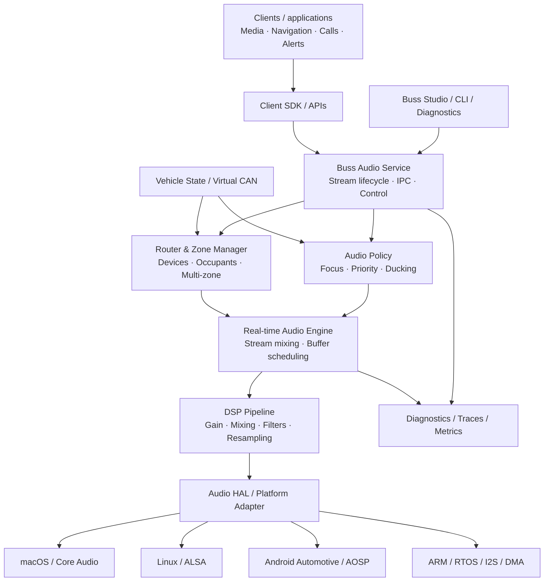

# Buss

**An automotive audio middleware platform built to learn and explore real-time audio, systems programming, and embedded software engineering.**

Buss is a C++20 project by **Neural Manacle**. Its long-term goal is to model the software between applications and audio hardware in a vehicle: stream management, audio focus, policy decisions, multi-zone routing, DSP processing, platform abstraction, diagnostics, and integration with automotive systems.

> **Project status: v0.1 foundation / early development.** The repository currently contains a CMake-based core static library with version metadata and a small CLI executable. The architectural components described below are **planned**, not implemented or validated. Buss is an independent learning project, not an OEM-certified product or a drop-in replacement for Android Automotive's audio stack.

## Goals

- Build a modular and testable automotive-inspired audio system, rather than a monolithic audio application.
- Understand the full path from an application audio request to an output device.
- Practice modern C++, real-time scheduling, concurrency, memory management, DSP, inter-process communication, and hardware abstraction.
- Progress from portable simulation on macOS to Linux audio, embedded hardware, and Android Automotive integration.
- Establish measurable correctness and performance criteria through automated tests, profiling, and diagnostics.

## What works today

| Component | Status | Description |
| --- | --- | --- |
| CMake project | Implemented | C++20, Debug/Release presets using Ninja |
| `Buss::Core` | Implemented | Static library exposing product name and version |
| `buss` CLI | Implemented | Prints project information and an initialization message |
| Unit tests | Planned | Testing enabled in CMake, but no test executable registered yet |
| Audio processing / routing | Planned | No working audio engine, policy, or HAL yet |

The CLI message **"System initialized"** currently indicates only that the executable started; it is not evidence that an audio subsystem is running.

## Architecture (target design)



This diagram is a **design destination**, not a depiction of current running components.

### Architectural responsibilities

| Subsystem | Planned responsibility | Key concepts to learn |
| --- | --- | --- |
| Core | Fundamental types, formats, buffers, errors, time, logging | C++20, RAII, ownership, API design |
| DSP | Mixing, gain, filters, resampling, signal metering | PCM, sample-rate conversion, FFT, numerical behavior |
| Engine | Real-time stream processing and scheduling | Callback deadlines, lock avoidance, atomics, ring buffers |
| Policy | Focus arbitration, priorities, ducking and interruptions | Audio focus, state machines, deterministic decisions |
| Router / Zones | Source-to-sink mapping across vehicle zones | Multi-zone audio, routing graphs, channel maps |
| HAL | Uniform interface for platform backends | Interfaces, adapters, hardware/software boundaries |
| Service / IPC | Control-plane service and client communication | Processes, messaging, synchronization |
| Vehicle | Simulated speed, ignition, alerts, and occupant state | Automotive signal integration, CAN concepts |
| Connectivity | Bluetooth audio integration and simulations | A2DP, HFP, BLE / LE Audio fundamentals |
| Diagnostics | Profiling, tracing, failure reproduction | Observability, latency, underruns, fault injection |

### Control plane vs. audio data plane

The **control plane** accepts requests such as “start navigation guidance” or “route media to the rear zone” and decides what should happen. The **audio data plane** processes PCM buffers under strict timing constraints. Keep blocking I/O, configuration parsing, dynamic allocation, and most logging outside real-time callbacks. Treat that as an architectural requirement to test, not a guarantee already achieved.

## Repository layout

Only `modules/core` and `apps/buss-cli` are currently committed as functional build targets. The rest of the layout is a planned direction.

```text
buss/
├── CMakeLists.txt
├── CMakePresets.json
├── apps/
│   └── buss-cli/                # Existing CLI
├── modules/
│   ├── core/                    # Existing Buss::Core
│   ├── dsp/                     # Planned
│   ├── engine/                  # Planned
│   ├── policy/                  # Planned
│   ├── router/                  # Planned
│   ├── zones/                   # Planned
│   └── hal/                     # Planned
├── services/                    # Planned control service / IPC
├── platforms/                   # Planned macOS, Linux, Android, embedded adapters
├── sdk/                         # Planned public client APIs
├── tests/                       # Planned automated tests
├── benchmarks/                  # Planned performance and stress testing
└── docs/                        # Planned architecture decisions and lessons
```

## Build and run

### Prerequisites

- CMake 3.25 or newer
- Ninja
- A compiler with C++20 support (Apple Clang, Clang, or GCC)
- macOS is the initial development environment; other platforms are future work.

### Debug build

```bash
git clone https://github.com/neuralmanacle/buss.git
cd buss
cmake --preset debug
cmake --build --preset debug
./build/debug/apps/buss-cli/buss
```

Expected CLI output:

```text
Buss Automotive Audio Platform
Version: 0.1.0
Developed by Neural Manacle
System initialized.
```

### Release build

```bash
cmake --preset release
cmake --build --preset release
./build/release/apps/buss-cli/buss
```

### Run tests (when implemented)

```bash
ctest --test-dir build/debug --output-on-failure
```

**Note:** At present, `ctest` has no registered Buss tests. A successful configure/build is not yet a system validation result.

## Product and learning roadmap

Each phase combines **something demonstrable** with **specific knowledge to acquire**. Versions are planning labels rather than promised release dates.

| Phase | Product deliverable | Learning focus | Completion evidence |
| --- | --- | --- | --- |
| **v0.1 — Foundations** (current) | Core audio types, buffers, errors, clocks; test infrastructure and CI | Modern C++, RAII, CMake, unit testing, sanitizers | Portable APIs and passing automated tests |
| **v0.2 — Audio engine** | Offline PCM mixer, gain pipeline, stream queues, callback-oriented engine | DSP fundamentals, real-time constraints, atomics, concurrency | Deterministic render tests, measured callback timing |
| **v0.3 — Policy and zones** | Audio focus state machine, ducking, priority rules, multi-zone routing | AAOS audio concepts, state modeling, routing | Reproducible media/navigation/call scenarios |
| **v0.4 — Service and IPC** | Standalone audio service, CLI control, client API | IPC, message protocols, process lifecycle | Multiple clients controlling a running service |
| **v0.5 — Virtual vehicle** | Vehicle-state simulator and diagnostics UI | Automotive events, observability, Qt/QML (optional) | End-to-end simulated drive scenarios |
| **v0.6 — Linux audio** | ALSA-backed playback and capture adapter | Linux audio stack, device handling, debugging | Running on supported Linux hardware |
| **v0.7 — Embedded audio** | Focused ARM/RTOS audio prototype | FreeRTOS, DMA, I2S, interrupts, memory and scheduling | Hardware demonstration with timing measurements |
| **v0.8 — Connectivity** | Simulated vehicle/CAN events; scoped Bluetooth integration | CAN fundamentals, Bluetooth profiles, coexistence concepts | Integration tests and documented limitations |
| **v0.9 — Android Automotive** | Experimental AOSP / AAOS adapter or reference integration | AudioFlinger, AudioPolicy, Binder/AIDL, Audio HAL | Reproducible build and tested integration on a defined target |
| **v1.0 — Validation** | Robust tests, profiling, fault injection, documentation | Reliability engineering, benchmarking, CI/CD | Published measurements and explicit platform support |

### Learning path: from source code to vehicle speaker

1. **PCM and DSP:** samples, frames, channels, interleaved/planar data, mixing, clipping, filtering, resampling.
2. **Real-time C++:** allocation strategies, data races, queues, atomic operations, cache behavior, callback deadlines.
3. **Linux and hardware:** processes, threads, ALSA, device nodes, I2S/TDM/PCM, DMA, codec and DSP interfaces.
4. **Automotive audio policy:** focus, ducking, routing, audio attributes, multi-zone and system sounds.
5. **Embedded systems:** ARM architecture, interrupts, RTOS scheduling, constrained memory and peripheral bring-up.
6. **Android Automotive:** AOSP architecture, AudioFlinger, AudioPolicyService/Manager, Binder/AIDL, Audio HAL, platform-level debugging.
7. **Verification:** unit/integration tests, sanitizers, traces, underrun reporting, latency distributions, hardware measurements.

## Design targets (not benchmark results)

Initial engineering targets, subject to validation and platform-specific revision:

| Metric | Proposed target |
| --- | --- |
| Nominal sample rate | 48 kHz |
| Processing block size | 256 frames |
| Nominal block interval | ~5.33 ms at 48 kHz |
| Concurrent active streams | Up to 16 |
| Independent audio zones | Up to 4 |
| Heap allocations inside the real-time callback | Zero |

The block interval is **not** a guarantee of end-to-end latency or proof of meeting deadlines. Eventually, tests should record callback execution time, jitter, underruns, routing correctness, peak memory, and performance across target devices.

## Engineering principles

- **Portable core first:** isolate OS and hardware dependencies behind clear interfaces.
- **No real-time surprises:** avoid allocations, blocking calls, and unbounded work in processing callbacks.
- **Make correctness visible:** test policy transitions, buffer behavior, and failure cases.
- **Measure before optimizing:** report actual latency and CPU usage instead of unverified claims.
- **Document trade-offs:** record architecture decisions, assumptions, and platform limitations.
- **Incremental, runnable milestones:** maintain a working CLI and demonstrable examples as the system grows.

## Contributing and project scope

Buss is currently a learning-driven project. Suggestions, technical feedback, issues, and focused contributions are welcome as the architecture evolves. Roadmap items should not be interpreted as existing API support.

**Maintainer:** Neural Manacle  
**Contact:** [neuralmanacle@gmail.com](mailto:neuralmanacle@gmail.com)  
**Blog:** [neuralmanacle.blog](https://www.neuralmanacle.blog/)

**License:** Not yet specified. Until a license is added, do not assume the repository grants open-source reuse permissions.
